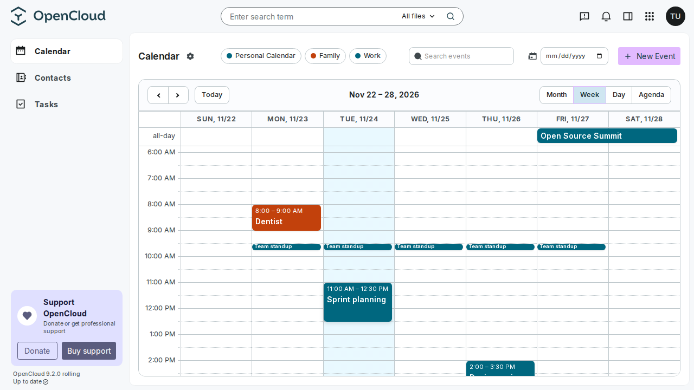
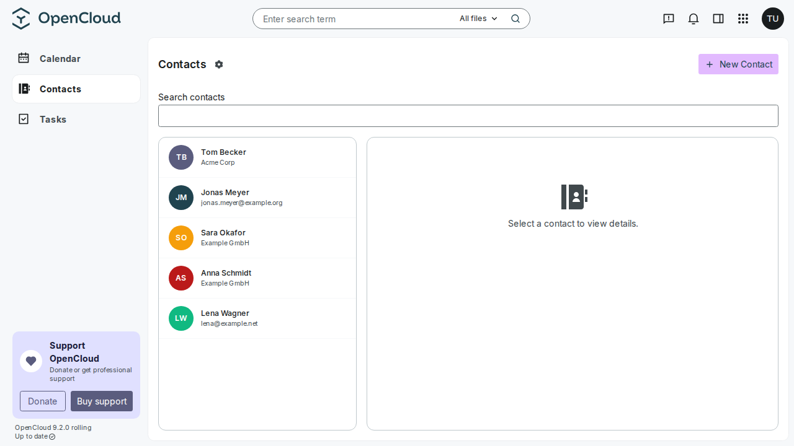
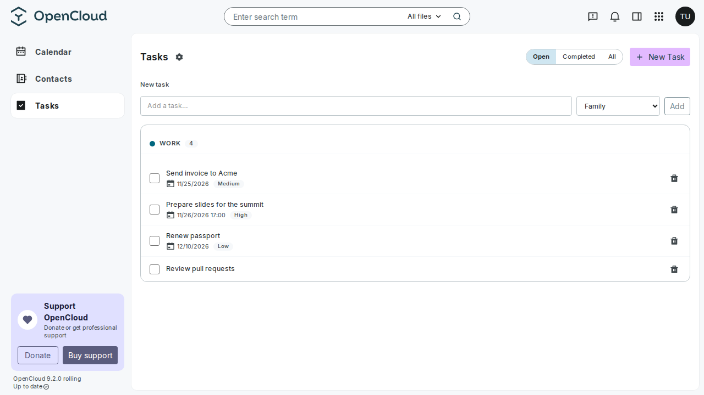
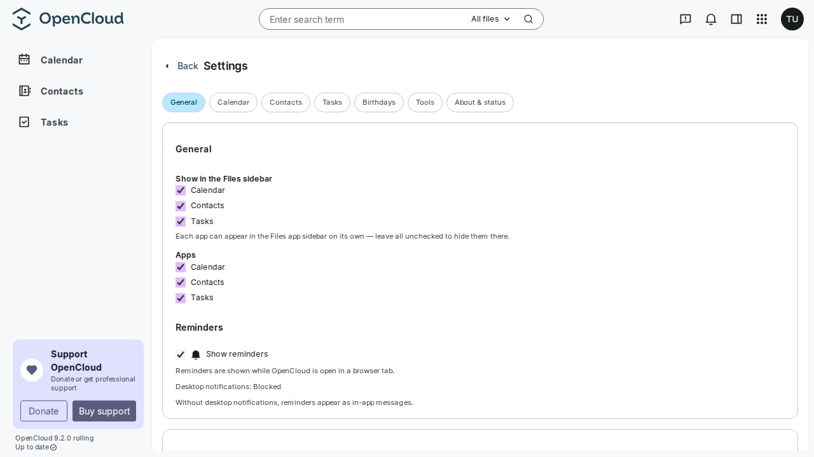
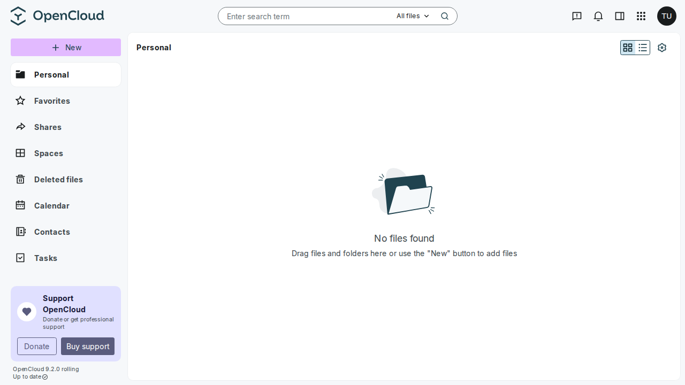
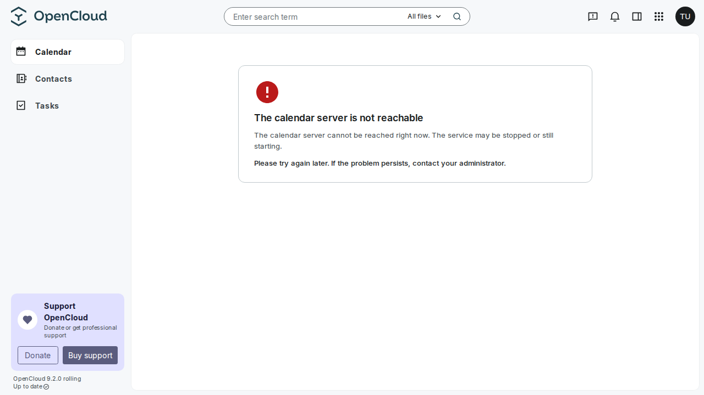

# OpenCloud Planner

[](https://github.com/r1cht4/opencloud-planner/actions/workflows/ci.yml)
[](https://github.com/r1cht4/opencloud-planner/releases/latest)
[](LICENSE)

**OpenCloud Planner** is a web extension for [OpenCloud](https://opencloud.eu) that adds
**Calendar**, **Contacts** and **Tasks** to the web UI. It needs no server component of its own: the
browser talks **CalDAV/CardDAV** directly to the **Radicale** server that OpenCloud ships and proxies
on the same origin (`/caldav/`, `/carddav/`).

One package provides the three apps. By default the app menu has a single **Planner** entry; a setting
can show Calendar, Contacts and Tasks as separate entries, and any of them can be pinned to the Files
app sidebar.

The name _Planner_ is a brand and is not translated. The technical app id is `planner`
(routes, folder names and storage keys are derived from it).

## Screenshots

| Screenshot                                                | Description                                                            |
| --------------------------------------------------------- | ---------------------------------------------------------------------- |
|  | Calendar — several calendars, recurring and all-day events             |
|                 | Contacts — searchable list with a detail panel                         |
|                       | Tasks — grouped by list, with due dates and priorities                 |
|                 | Settings — preferences, opened with the gear in the app header         |
|       | Calendar, Contacts and Tasks can sit in the Files app sidebar          |
|                | First run — what users and admins see when the calendar server is down |

## Features

### Calendar

- Day, week, month and list views
- Drag-and-drop rescheduling and resizing, with a confirmation that shows the old and new dates
- Click-to-create on a slot, or drag a range to create an event
- Recurring events (daily, weekly, monthly, yearly); single occurrences can be edited or deleted
- Several calendars at once, with their CalDAV colours and per-calendar visibility
- Alarms (`VALARM`), stored in the event itself and selectable in the dialog
- Organizer and participants shown read-only; the invitation data is preserved verbatim on save
- Event search across the loaded range (title, location, description), keyboard navigable
- `.ics` import/export, week numbers, all-day events, dark mode
- Touch support: long-press an event to drag or resize it, long-press an empty slot to drag out a new
  event, tap to open; swiping still scrolls the grid

### Tasks

- Dedicated page for CalDAV **VTODO** objects in every task-capable calendar
- Quick-add and a full dialog (title, description, due date with optional time, priority, calendar)
- Complete and reopen with one checkbox, filters for open/completed/all, overdue marking
- Edits patch the stored item, so properties written by other clients survive; conflicts are detected
  through ETags

### Contacts

- Searchable, sortable contact list with a detail panel; create, edit, delete
- Name, e-mail, phone, several addresses, organization, title, notes, categories, photo, birthday
- `.vcf` import/export, Google/Outlook CSV import/export, field-by-field duplicate merge
- Birthday calendar: contact birthdays materialised as yearly recurring events

### Reminders

- Browser reminders for events and tasks: every alarm due in the next 24 hours fires while an
  OpenCloud tab is open
- System notifications after an explicit _Allow_, in-app messages otherwise; one reminder across all
  open tabs

### Settings, data and tools

- Settings page (gear icon in every app header) with the tabs General, Calendar, Contacts, Tasks,
  Data, Devices and About
- Settings are stored per user as one document on the DAV server, so they follow the user to every
  device; administrators can ship defaults and lock individual values
- Tools: collection manager (create, rename, recolour, delete), import/export, backup and restore of
  all calendars and address books as one zip, contacts CSV, duplicate-event cleanup, birthday
  calendar, "connect your devices"
- First-run and status screen: when the DAV backend is unreachable the apps explain why and show
  administrators the fix
- **Import into calendar** / **Import into contacts** in the Files app context menu for `.ics` and
  `.vcf` files

## Requirements

| Component              | Note                                                                                |
| ---------------------- | ----------------------------------------------------------------------------------- |
| OpenCloud server       | 9.x or newer (tested with 9.2.0)                                                    |
| CalDAV/CardDAV backend | Radicale, as shipped in upstream `opencloud-compose` and proxied on the same origin |
| Browser                | any current Chrome, Firefox, Safari or Edge                                         |

The app sends CalDAV/CardDAV requests only to the origin it is loaded from and makes no external
requests. No credentials are stored in the browser; user data stays on your server.

## Install and update

- **OpenCloud app store**: install and update from the app store in the OpenCloud web UI.
- **Release zip**: download `planner-<version>.zip` from the
  [releases page](https://github.com/r1cht4/opencloud-planner/releases) and extract it
  into the OpenCloud apps folder, then restart OpenCloud and hard-reload the browser. Checksums are
  published next to the archive.

Server-side setup (Radicale, proxy routes, app tokens for native clients) and the exact install,
update and uninstall commands are in **[docs/INSTALL.md](docs/INSTALL.md)**.

## Administration

Administrators can point the app at other DAV endpoints, choose which apps are offered, set defaults
for every user and lock settings. Everything is optional — without configuration the app works
against the same-origin `/caldav/` and `/carddav/` endpoints. All keys live under the `config:` block
of the `planner` entry in OpenCloud's `apps.yaml`; see
**[docs/ADMIN-CONFIG.md](docs/ADMIN-CONFIG.md)** for the full reference and examples:

```yaml
planner:
  config:
    enabledApps: [calendar, contacts, tasks]
    defaults:
      calendar:
        weekStart: 1
        dayStart: '08:00'
    locked:
      - general.navigation
```

## Native clients

DAVx5 (Android), Thunderbird and the iOS/macOS Calendar and Contacts apps sync with the same server:
address `https://<your-opencloud-host>`, user name and an **app token** created on the OpenCloud
account page. See [docs/INSTALL.md](docs/INSTALL.md#4-optional-app-tokens-for-phones-and-desktop-clients).

## Development

Node.js 20 or newer and pnpm (via `corepack enable`) are required.

```bash
pnpm install          # dependencies
pnpm build            # production build into dist/
pnpm build:w          # build in watch mode
pnpm lint             # eslint
pnpm check:types      # vue-tsc --noEmit
pnpm test:unit        # unit tests (tests/unit/)
pnpm test:e2e         # Playwright against a live instance (OPENCLOUD_URL/USERNAME/PASSWORD)
pnpm format:check     # prettier
```

Translations use the gettext workflow of the official OpenCloud web extensions:

```bash
pnpm l10n:extract     # extract $gettext strings -> l10n/template.pot (+ merge into the .po files)
pnpm l10n:compile     # compile l10n/locale/{de,fr,es}/app.po -> l10n/translations.json
pnpm l10n:check       # every string translated in de/fr/es and the catalog in sync
```

`pnpm l10n:extract` needs the GNU gettext binaries (`msgmerge`, `msginit`) on the `PATH`. Without
them it still regenerates `l10n/template.pot`, and `pnpm l10n:check` reports what is missing.
`msgmerge` pre-fills new strings with similar old translations marked `#, fuzzy`; review those and
remove the flag, because fuzzy entries are not used by the compiled catalog.

A local OpenCloud plus Radicale setup for development is in `docker-compose.yml` (it mounts the build
output `dist/` as the app folder, so run `pnpm build` or keep `pnpm build:w` running). `dist/` is not
committed — only the release zip ships a build. Release archives are built with
`bash scripts/release.sh`.

Further reading:

- **[docs/ARCHITECTURE.md](docs/ARCHITECTURE.md)** — how the app works, host integration rules and
  data-handling principles
- **[CONTRIBUTING.md](CONTRIBUTING.md)** — how to build, test and contribute
- **[CHANGELOG.md](CHANGELOG.md)** — release history, **[ROADMAP.md](ROADMAP.md)** — planned work and
  known limitations
- **[SECURITY.md](SECURITY.md)** — how to report a vulnerability

## Credits

- [ical.js](https://github.com/kewisch/ical.js) (MPL-2.0) for iCalendar parsing
- [@event-calendar/core](https://github.com/vkurko/calendar) (MIT) for the calendar grid

## Licence

Apache-2.0 — see [LICENSE](LICENSE). The licences of bundled third-party code are listed in
[THIRD-PARTY-LICENSES](THIRD-PARTY-LICENSES).
